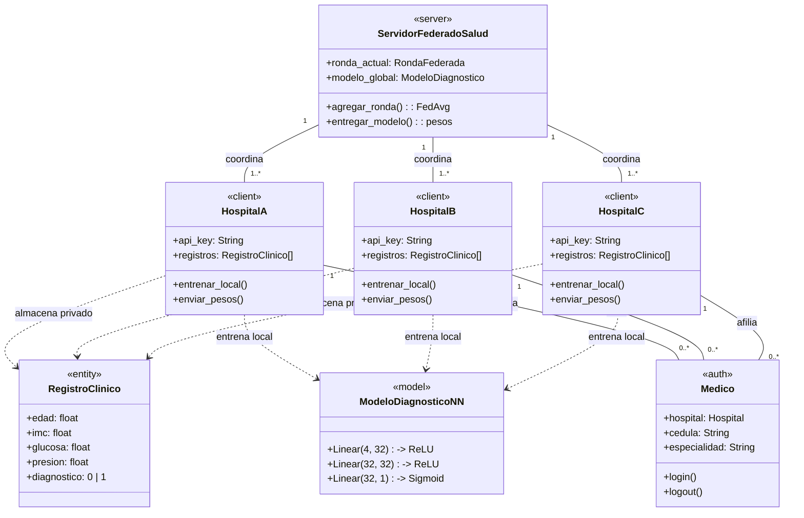

# 🏥 Sistema Sanitario de Aprendizaje Federado para Diagnóstico de Diabetes

Aplicación integral de **Aprendizaje Federado (Federated Learning)** aplicada al sector salud. Permite que múltiples hospitales (**HospitalA**, **HospitalB**, **HospitalC**) entrenen conjuntamente una red neuronal multicapa (MLP) en **PyTorch** para el diagnóstico precoz de diabetes **sin compartir jamás los registros clínicos privados de los pacientes**.

El backend está orquestado con **Django**, autenticación médica mediante `AbstractUser`, persistencia documental en **MongoDB** y el algoritmo de agregación **FedAvg** (*Federated Averaging*).

---

## 📐 Diagrama de Clases UML del Sistema



---

## 🔄 Flujo Completo de la Aplicación

1. **Autenticación Médica:** El médico facultativo inicia sesión con `username` y `password` en `POST /login/` mediante Django Auth.
2. **Descarga del Modelo Global:** El agente de cada hospital solicita el modelo global vigente en `GET /api/modelo/` autenticándose con su cabecera `X-API-KEY`.
3. **Entrenamiento Local Privado (PyTorch):** El hospital reconstruye la red `ModeloDiagnosticoNN` en memoria local y la entrena sobre sus historias clínicas privadas. Los datos de los pacientes nunca abandonan el hospital.
4. **Reporte de Pesos:** El hospital extrae el `state_dict` de PyTorch y envía los pesos a `POST /api/actualizaciones/`.
5. **Agregación con FedAvg:** Cuando el servidor central recibe las actualizaciones de la ronda, ejecuta la fórmula de **FedAvg** ponderada por número de muestras ($W = \sum \frac{n_k}{N} W_k$).
6. **Persistencia en MongoDB y Visualización:** El nuevo modelo agregado se persiste en MongoDB (`salud_federada.modelos_globales`). El médico supervisa la evolución en `/dashboard/` y puede realizar diagnósticos interactivos en tiempo real.

---

## 🛠️ Puesta en Marcha Rápida

### 1. Inicializar Base de Datos, Médicos y MongoDB
```bash
python init_system.py
```

### 2. Iniciar el Servidor Django
```bash
python manage.py runserver
```
Acceder a la aplicación web: [http://127.0.0.1:8000/login/](http://127.0.0.1:8000/login/)

**Credenciales de médicos de prueba:**
- **HospitalA:** Usuario `dr_garcia` | Contraseña `medico123`
- **HospitalB:** Usuario `dra_rodriguez` | Contraseña `medico123`
- **HospitalC:** Usuario `dr_santos` | Contraseña `medico123`

### 3. Ejecutar la Simulación de Hospitales Federados
En otra terminal, ejecute el agente distribuido:
```bash
python client_hospital.py
```
O simular un único hospital:
```bash
python client_hospital.py --hospital HospitalA
```
